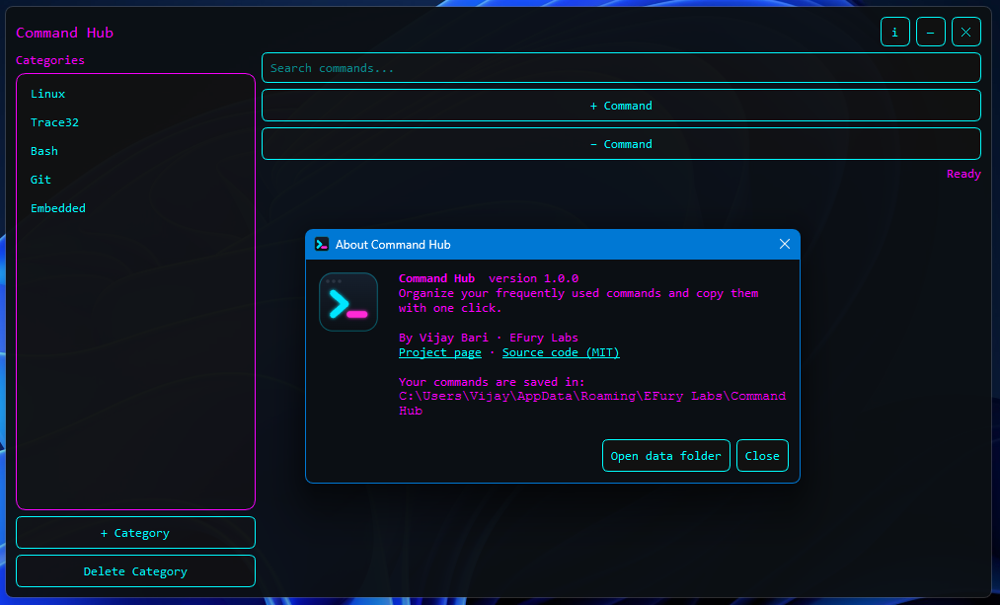
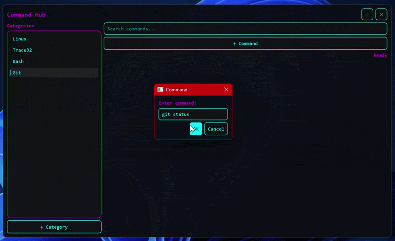

<div align="center">

# Command Hub

**A modern command manager built with Python and PyQt6**

Organize the commands you use every day into categories and copy any of them to your clipboard with a single click.




### [⬇ Download for Windows](https://github.com/EFuryLabs/command-hub/releases/latest)

Windows 10/11 · 64-bit · one installer · **no Python needed**

[**Part 1 video: building the app**](https://youtu.be/sEPDEN9yzwQ) · [**Part 2 video: the Windows installer**](https://github.com/EFuryLabs/command-hub/releases/latest) · [**Project page**](https://efurylabs.com/projects/python-command-hub.html) · [**EFury Labs on YouTube**](https://www.youtube.com/@EFuryLabs)

</div>

---

## Contents

- [What it is](#what-it-is)
- [Install (Windows)](#install-windows)
- [Features](#features)
- [Demo](#demo)
- [Videos](#videos)
- [Run it from source](#run-it-from-source)
- [How to use](#how-to-use)
- [Where your commands are stored](#where-your-commands-are-stored)
- [Build the Windows installer](#build-the-windows-installer)
- [Releasing a new version](#releasing-a-new-version)
- [Project structure](#project-structure)
- [Technologies](#technologies)
- [Roadmap](#roadmap)
- [Contributing](#contributing)
- [Licence](#licence)

---

## What it is

Every developer has a handful of long commands they retype or dig out of shell history all day: Git steps, build flags, debugger scripts, ADB commands. Command Hub keeps them in categories, in a small window, and copies any of them to your clipboard in one click.

- **One Python file** (`main.py`) — easy to read, easy to change.
- **No accounts, no cloud, no internet.** Your commands are a plain JSON file on your own computer.
- **Commands are only copied, never executed.** Nothing runs until you paste it yourself.
- **MIT licensed.** Use it, modify it, ship it.

---

## Install (Windows)

1. Download **`CommandHub-Setup-<version>.exe`** from the [latest release](https://github.com/EFuryLabs/command-hub/releases/latest).
2. Run it and pick the install mode:

   | Mode | Admin prompt | Installs to |
   |---|---|---|
   | **Only for me** | No | `%LOCALAPPDATA%\Programs\EFury Labs\Command Hub` |
   | **All users** | Yes (UAC) | `C:\Program Files\EFury Labs\Command Hub` |

3. Next → Install → Finish. Command Hub starts, and it is in your Start menu (with an optional desktop shortcut).

**Uninstall:** Settings → Apps → Installed apps → Command Hub → Uninstall. It asks whether to delete your saved commands too — answer **No** and they will still be there if you reinstall later.

**Upgrade:** download the newer `Setup.exe` and run it over the old install. Every version uses the same AppId, so it upgrades in place and keeps your commands. No need to uninstall first.

> **SmartScreen warning:** the installer is not code-signed, so Windows may show *"Windows protected your PC"* on first run. Click **More info → Run anyway**. You do not have to take that on trust — every release includes a `.sha256.txt` file, and you can check your download:
>
> ```bat
> certutil -hashfile CommandHub-Setup-1.0.0.exe SHA256
> ```

**Requirements:** Windows 10 or 11, 64-bit. Nothing else — Python is bundled inside the app.

---

## Features

| | |
|---|---|
| **Categories** | Group commands as Git, Linux, Docker, Trace32, ADB or anything else you use |
| **One-click copy** | Every command is a button; click it and it is on your clipboard |
| **Instant search** | Filter the selected category by name as you type |
| **Hover preview** | The tooltip shows the full command before you copy it |
| **Add & delete** | Commands and categories, each with a confirmation before anything is removed |
| **Your data, in one place** | Saved to `%APPDATA%\EFury Labs\Command Hub\commands.json` — it survives updates and uninstalls |
| **Safe saving** | Written to a temporary file and swapped in, so a crash mid-save cannot corrupt your list |
| **Damaged file handling** | A broken `commands.json` is backed up and reported instead of being silently overwritten |
| **Single instance** | Starting it again brings the running window forward instead of opening a second copy |
| **About box** | The **i** button shows the version and opens your data folder |
| **Clear errors** | Anything unexpected is written to `error.log` and shown in a dialog — no silent crashes |
| **Installer** | Start menu entry, optional desktop shortcut, clean uninstall, in-place upgrades |
| **Frameless window** | Its own title bar, styled with Qt Style Sheets, with its own taskbar icon |
| **Cross-platform source** | The app runs on Windows, Linux and macOS from the same file |

---

## Demo



---

## Videos

| | Video | Covers |
|---|---|---|
| **Part 1** | [I Built a Python Command Hub \| PyQt6 GUI App for Faster Workflows](https://youtu.be/sEPDEN9yzwQ) | Building the app: PyQt6 widgets, the frameless window, JSON storage, clipboard integration, QSS styling |
| **Part 2** | *link added when published* | Packaging it for Windows: PyInstaller, Inno Setup, AppData storage, upgrades, GitHub release |

The written walkthrough is on the [EFury Labs project page](https://efurylabs.com/projects/python-command-hub.html).

---

## Run it from source

Requirements: **Python 3.10+** and pip.

```bash
git clone https://github.com/EFuryLabs/command-hub.git
cd command-hub

python -m venv venv
venv\Scripts\activate            # Windows   (Linux/macOS: source venv/bin/activate)

pip install -r requirements.txt
python main.py
```

The app opens with sample commands (Linux, Trace32, Bash, Git and Embedded) so there is something to click straight away — replace them with your own.

---

## How to use

| Action | How |
|---|---|
| **Create a category** | Click **+ Category** and enter a name, e.g. `Git`, `Docker`, `ADB` |
| **Select a category** | Click it in the left panel; its commands appear as buttons on the right |
| **Add a command** | With a category selected, click **+ Command**, enter a name (`Git Pull`), then the command (`git pull origin main`) |
| **Copy a command** | Click its button. The status line shows `Copied: …` — paste with **Ctrl + V** |
| **Preview a command** | Hover over its button |
| **Search** | Type in the search bar to filter the selected category by name |
| **Delete a command** | Click the command first (this selects it), then **− Command**, and confirm |
| **Delete a category** | Select it, click **Delete Category**, and confirm. This also removes its commands |
| **About / data folder** | Click **i** |
| **Move the window** | Drag any empty part of it. **—** minimises, **✕** closes |

---

## Where your commands are stored

Your commands live in a single plain JSON file, outside the program folder:

| Platform | Path |
|---|---|
| Windows | `%APPDATA%\EFury Labs\Command Hub\commands.json` |
| Linux | `~/.local/share/EFury Labs/Command Hub/commands.json` |

```json
{
  "Git": [
    {
      "name": "Git Status",
      "command": "git status"
    },
    {
      "name": "Push",
      "command": "git push origin main"
    }
  ]
}
```

- On the first start, the sample commands are copied there automatically.
- The file is rewritten after every add or delete — through a temporary file, so an interrupted save cannot corrupt it.
- If the file is damaged, the app keeps a copy as `commands.broken-<date>.json`, tells you what happened, and starts empty instead of overwriting your data.
- Because it lives outside the program folder, your data survives updates and uninstalls.
- It is plain text: back it up by copying it, or keep it in a private Git repository. Editing it while the app is closed works too.
- **i → Open data folder** takes you straight there.

There is no cloud storage, no account and no internet connection involved.

---

## Build the Windows installer

Everything is scripted — there is no manual step.

**One-time setup:**

| Tool | Where |
|---|---|
| Python 3.10+ | python.org |
| [Inno Setup 7](https://jrsoftware.org/isdl.php) (free) | jrsoftware.org |

Then, from the project folder:

```bat
build-installer.bat
```

| Step | What it does | Output |
|---|---|---|
| 1/5 | Creates `venv`, installs `requirements.txt` + `requirements-build.txt` | — |
| 2/5 | Reads `VERSION` from `app_info.py` | — |
| 3/5 | Builds the app with PyInstaller (`CommandHub.spec`) | `dist\CommandHub\CommandHub.exe` |
| 4/5 | Builds the installer with Inno Setup (`installer\CommandHub.iss`) | **`installer\Output\CommandHub-Setup-<version>.exe`** |
| 5/5 | Writes a SHA-256 checksum | `…-Setup-<version>.exe.sha256.txt` |

It finishes by opening `installer\Output` in Explorer.

**The version lives in exactly one place** — `VERSION` in `app_info.py`. The window title, the About box, the `.exe` properties and the installer all read from it.

Before releasing, test the built installer — at minimum these four:

- **Only for me** installs with no admin prompt; **All users** asks for admin and lands in `C:\Program Files`;
- the app starts from the Start menu with its own icon, and About (**i**) shows the new version;
- add a command, close the app, reopen it — the command is still there;
- uninstall asks about your saved commands, and answering **No** keeps them.

---

## Releasing a new version

1. **Set the version** in `app_info.py` (`VERSION = "1.0.1"`) and add a section to `CHANGELOG.md`.
2. **Build:** run `build-installer.bat`.
3. **Test** the Setup file from `installer\Output` (also test the upgrade over the previous version, if you have it installed).
4. **Commit** the source (`build/`, `dist/` and `installer\Output\` are ignored on purpose — never commit the installer).
5. **Tag and publish:**

   ```bat
   git push origin main
   git tag -a v1.0.1 -m "Command Hub v1.0.1"
   git push origin v1.0.1
   gh release create v1.0.1 ^
     "installer\Output\CommandHub-Setup-1.0.1.exe" ^
     "installer\Output\CommandHub-Setup-1.0.1.exe.sha256.txt" ^
     --title "Command Hub v1.0.1" --notes-file RELEASE-NOTES-v1.0.1.md --verify-tag
   ```

   `RELEASE-NOTES-v1.0.1.md` is simply a text file with your release notes (what changed, install instructions, the SHA-256, known limitations) — keep it out of the repository or in it, whichever you prefer. Without the GitHub CLI, use **Releases → Draft a new release** on the repository page: pick the tag, paste the notes and attach the two files.

6. **Never change the `AppId`** in `installer\CommandHub.iss`. It is what makes a new version upgrade the old one instead of installing a second copy.

The `/releases/latest` link always points at the newest release, so the download link in this README, the videos and the website never has to be updated again.

---

## Project structure

```text
command-hub/
├── main.py                    # the whole application
├── app_info.py                # name, version, publisher - the ONE place for the version
├── commands.json              # sample commands, copied to the data folder on first run
├── assets/
│   ├── app.ico                # window, taskbar and installer icon
│   ├── app-icon-256.png
│   ├── screenshot.png
│   └── demo.gif
├── installer/
│   └── CommandHub.iss         # Inno Setup script  ->  Setup.exe
├── CommandHub.spec            # PyInstaller build file  ->  CommandHub.exe
├── build-installer.bat        # builds the app and the installer in one click
├── requirements.txt           # to run the app
├── requirements-build.txt     # to build the app
├── HOW-THE-BUILD-FILES-WORK.md
├── CHANGELOG.md
├── LICENSE
└── README.md
```

---

## Technologies

- **Python 3.10+**
- **PyQt6** — Qt Widgets, `QGuiApplication.clipboard()`
- **Qt Style Sheets (QSS)** for the interface
- **JSON** for storage
- **PyInstaller** (app → `.exe`) and **Inno Setup** (`.exe` → installer)

---

## Roadmap

- [x] Add and delete categories
- [x] Add and delete commands
- [x] Search, tooltips and one-click copy
- [x] Windows installer with in-place upgrades
- [ ] Edit commands in place
- [ ] Import / export JSON
- [ ] SQLite support

Ideas and bug reports are welcome in [Issues](https://github.com/EFuryLabs/command-hub/issues).

---

## Contributing

1. Fork the repository and create a branch.
2. Keep the code readable — one file, plain PyQt6, no new dependencies unless they earn their place.
3. Open a pull request describing what changed and why. Screenshots help for interface changes.

If you report a bug, please say which version you are using (click **i** in the app) and what you expected to happen.

---

## Licence

MIT — see [LICENSE](LICENSE).

Built by **[EFury Labs](https://efurylabs.com)**. If Command Hub saves you some typing, a ⭐ on the repository is appreciated.
